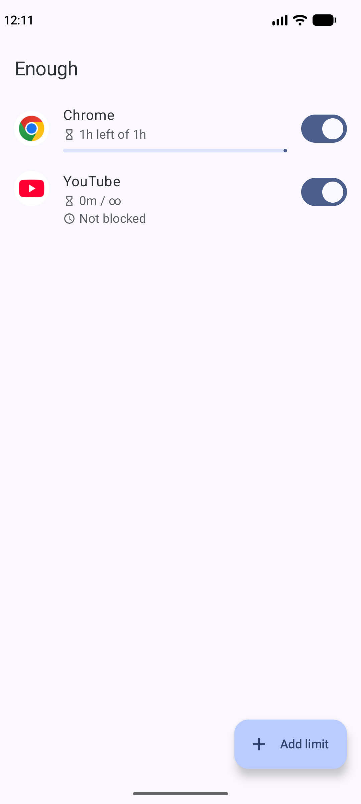
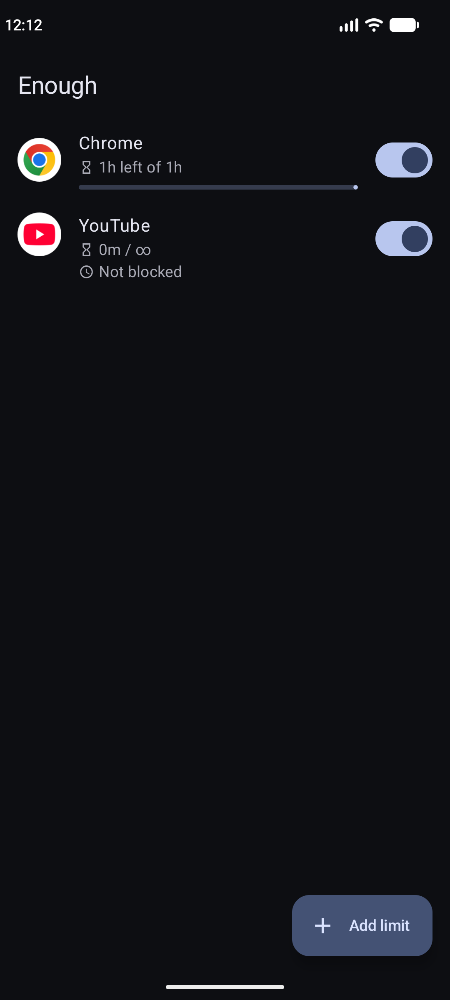
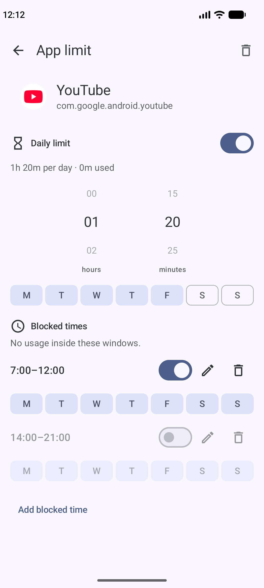
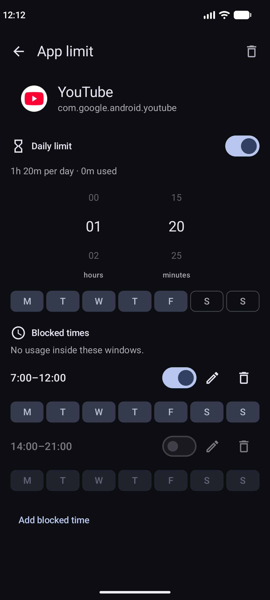

# Enough

Per-app screen time limits for Android. Pick an app, give it a daily quota
and/or blocked time windows, and Enough steps in when the quota runs out
or a window starts.

Everything except the listed apps stays untouched.

## Screenshots

| Light | Dark |
|---|---|
|  |  |
|  |  |

## How it works

- **Daily quota** — e.g. 25 minutes of Instagram a day. Counted from
  midnight in your timezone, from raw usage events. A reminder fires
  5 minutes before the quota runs out.
- **Blocked windows** — e.g. no YouTube 7:00–12:00 on weekdays.
  Windows win over quotas when both apply.
- **Enforcement** — a lightweight foreground service watches the
  foreground app (only while the screen is on) and an accessibility
  service reacts instantly where available. When an app is blocked you
  get a full-screen notice with a Close button.

## Permissions

The app asks for exactly what the job needs, nothing else (no network
access at all):

- Usage access — to measure screen time.
- Notifications — for block alerts and quota reminders.
- Display over other apps + full-screen intent — to show the block screen.
- Accessibility service (optional) — for immediate blocking.
- Battery optimization exemption — so the background check survives.

## Building

```sh
./gradlew :app:assembleRelease
```

Signing a release needs a keystore; see the comments in
`app/build.gradle.kts` (`ENOUGH_KEYSTORE_*` env vars or `local.properties`).
Unit tests: `./gradlew :app:testDebugUnitTest`.

Requires Android 12 (API 31) or newer.

## License

GPL-3.0 — see [LICENSE](LICENSE).
